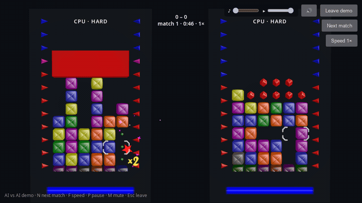
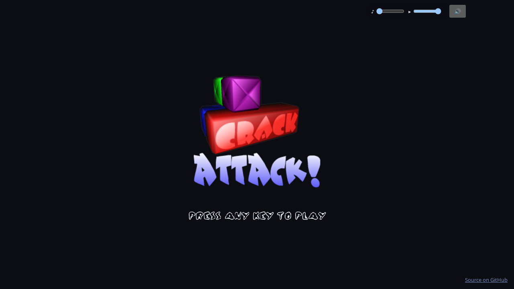
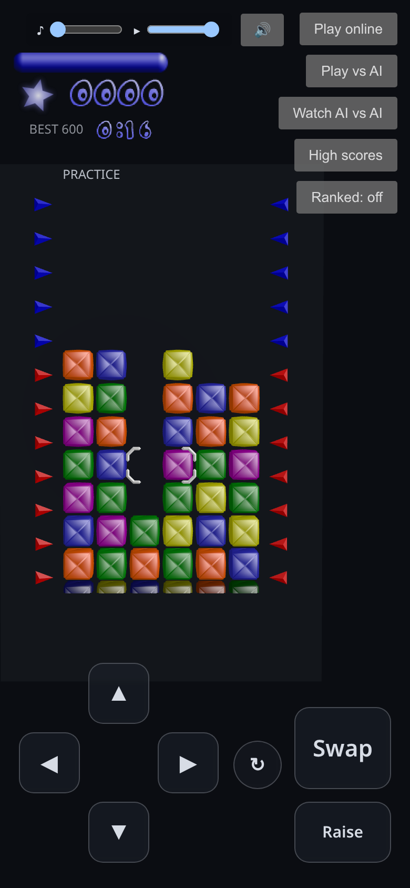
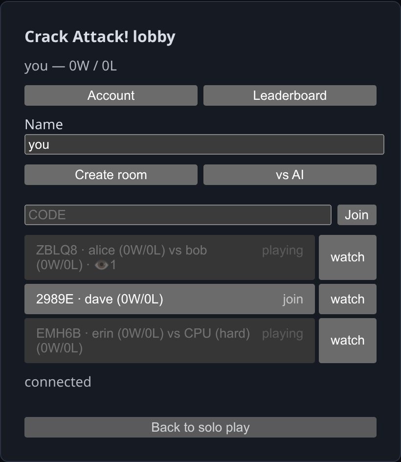

# Crack Attack! (web)

A browser port of [Crack Attack!](https://www.nongnu.org/crack-attack/), the GPL
clone of Tetris Attack, from C++/OpenGL to TypeScript and Three.js. The rules
are translated tick for tick from the original, so it plays the same game.

**Play it: [c-a.foggyden.org](https://c-a.foggyden.org/)**



- **Solo**, with online high-score boards. The server replays every submitted
  run to check its score.
- **Against the AI**: Easy, Medium or Hard. The bot plays a real board, and Hard
  builds chains and digs out garbage on purpose.
- **Online**: a lobby with rooms, spectators, reconnects after a dropped
  connection, and accounts with a rated ladder (Glicko-2) and a queue that
  pairs players of close ratings.
- **AI vs AI**: the title screen plays matches between bots, like an arcade
  cabinet's attract mode. **Watch AI vs AI** picks the bots.
- **Phones**: the boards scale to the screen, with touch controls.

<table>
  <tr>
    <td></td>
    <td rowspan="2"></td>
  </tr>
  <tr>
    <td></td>
  </tr>
</table>

## Controls

- **← → ↑ ↓** move the cursor · **Z** / **Space** swap · **X** raise the stack
- **R** restart (solo) / ready-rematch (netplay) · **P** pause (solo) · **M** mute
- **Esc** concede / stop watching (netplay)
- AI vs AI: **N** next match · **F** 1×/2×/4× speed · **P** pause · **Esc** leave
- Music starts **off** (sound effects are on); turn it up with the ♪ slider at
  the top right, and the setting is remembered.

## Run it locally

You need **Node** `>=22.13.0` and **pnpm** 9. The repo pins pnpm in
`packageManager`, so `corepack enable` (Corepack comes with Node) gets the
right version; `npm i -g pnpm@9` works too.

```sh
pnpm install
pnpm --filter @crack-attack/client dev
```

Vite serves the game at <http://localhost:5173>. Solo, vs AI and AI vs AI need
nothing else. Online play and ranked solo runs need the relay too:

```sh
pnpm --filter @crack-attack/server build
CORS_ORIGIN=http://localhost:5173 pnpm --filter @crack-attack/server start
```

It listens on port 8080, where the client looks for it. Without it, solo still
plays, unranked.

To try netplay on one machine, open the game in two different browsers (or a
private window for the second player): the identity lives in `localStorage`, so
two tabs of one browser are the same player. Click **Play online**, **Create
room** in one, and click the room in the other's lobby. A third can **watch**.

### URL parameters

With no parameters the game opens in attract mode: the title card, then
hard-vs-hard AI matches, until you press a key or click, which starts a solo
game.

- `?solo` boots straight into solo play; `?net` into the online lobby.
- `?scores` opens the high-score boards; `?ladder` the rated leaderboard
  (`?ladder=<handle>`, a player's page); `?account` the account screen.
- `?demo` plays AI vs AI with the viewer's controls (hard vs hard);
  `?demo=easy,hard` picks the left and right bots.
- `?relay=<url>` uses another relay, e.g. `?relay=wss://example.com/ws`.
- `?tune` opens the lighting and material tuner (a dev aid).

## Development

```sh
pnpm build          # compile everything (tsc -b, project references)
pnpm test           # run the tests once (Vitest); pnpm test:watch to watch
pnpm typecheck      # type-check without emitting (tsc -b)
pnpm lint           # eslint .
pnpm format         # prettier --write . (format:check to check)
pnpm clean          # tsc -b --clean
```

Tests sit beside the source as `*.test.ts`. One file:
`pnpm exec vitest run packages/core/src/aiController.test.ts`.

| Package             | What it is                                                          |
| ------------------- | ------------------------------------------------------------------- |
| `packages/core`     | Deterministic simulation: zero deps, runs in the browser and Node.  |
| `packages/protocol` | Wire message types + codec shared by client and server.             |
| `packages/client`   | Three.js renderer, input, HUD, audio (a Vite app).                  |
| `packages/server`   | Lobby + lockstep relay + scoreboard + ladder (Node, `ws`, SQLite).  |
| `tools/`            | Dev tooling: the AI arena, replay checks, asset conversion and more |

The production build is `pnpm --filter @crack-attack/client build`, into
`packages/client/dist/web`; `preview` serves it. It must be served over
HTTP(S), not opened from disk.

`AGENTS.md` has the architecture and the port's status, and
`BROWSER_PORT_PLAN.md` the plan. More:

- [The relay](docs/RELAY.md): its settings, the scoreboard, accounts, rated
  games, their HTTP APIs and limits, and how the client finds the relay.
- [Deploying](docs/DEPLOYING.md): the game and the relay on a Linux server
  with nginx, and running them there.
- [Tools](tools/README.md), among them `ai-arena`, which pits AI tunings
  against each other over reproducible seeds:
  `node tools/ai-arena/dist/cli.js --a candidate.json --b hard --seeds 50`.
- Screenshots: `pnpm --filter @crack-attack/screenshots shoot` retakes the ones
  above (see [`tools/screenshots`](tools/screenshots/README.md)).

## The C++ reference

The port is made from the original C++ Crack Attack!,
<https://github.com/gnu-lorien/crack-attack>. It isn't needed to build or run
this port; it's what the port is translated from and checked against.

## License

GPL-2.0-or-later. The original Crack Attack! is GPL v2; this port and any
converted assets are kept GPL-compatible. See `COPYING`, and
`packages/client/public/AUDIO_COPYRIGHT.txt` for audio-asset provenance.
Account keys are drawn from the EFF long wordlist
(`packages/server/src/wordlist.ts`), by the Electronic Frontier Foundation,
under CC BY 3.0 US.
